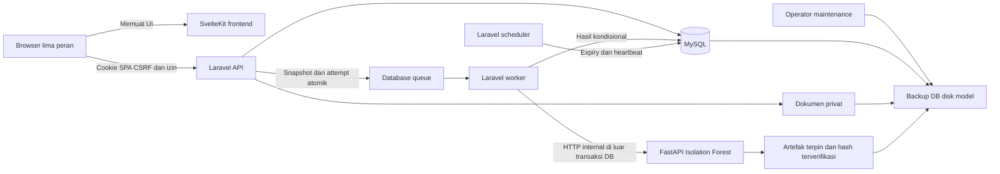
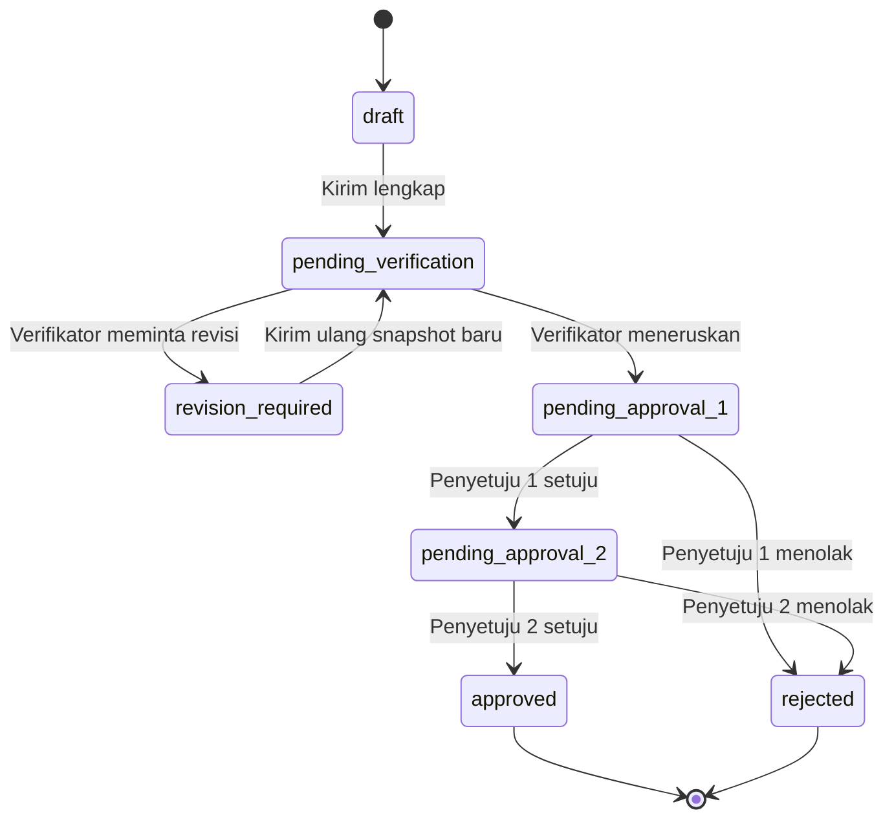
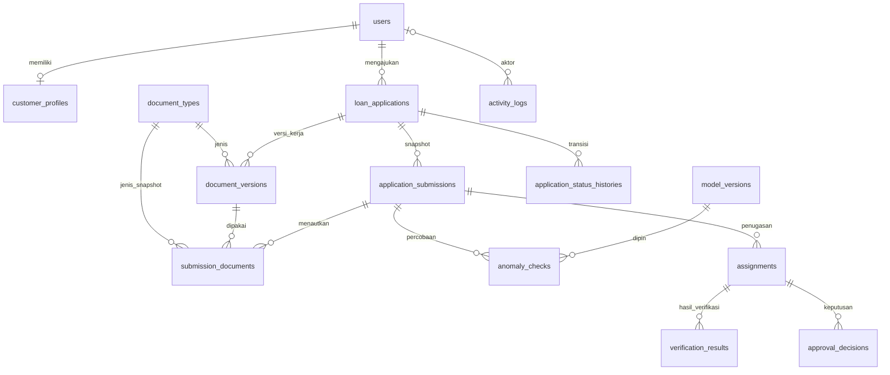

# Gambaran sistem Lendara

Diagram ini merangkum implementasi untuk serah terima. Spesifikasi rinci tetap [SPECIFICATION](SPECIFICATION.md), [DATABASE](DATABASE.md), [API_CONTRACT](API_CONTRACT.md) dan [ML_SERVICE](ML_SERVICE.md). Sumber Mermaid tersedia di bawah; pratinjau PNG dan SVG juga tersedia tanpa plugin viewer. Ketiga diagram berhasil diparse/dirender di Chrome dan ditinjau visual pada16 November2026.

## Berkas visual

| Diagram | PNG | SVG untuk diperbesar |
|---|---|---|
| Arsitektur | [PNG arsitektur](diagrams/architecture.png) | [SVG arsitektur](diagrams/architecture.svg) |
| Alur status | [PNG alur](diagrams/workflow.png) | [SVG alur](diagrams/workflow.svg) |
| Relasi domain | [PNG relasi](diagrams/domain-relations.png) | [SVG relasi](diagrams/domain-relations.svg) |

## Komponen dan batas akses



SvelteKit melayani UI; permintaan akun/API dilakukan browser dengan credentials dan X-XSRF-TOKEN, tanpa store pengguna global SSR. FastAPI hanya menerima key internal melalui backend/worker. Unduhan dokumen melalui endpoint berizin, tanpa public storage link. Akun admin tidak otomatis mendapat akses dokumen nasabah. Session/cache/queue memakai database; runtime DB terpisah dari operator.

## Alur bisnis



Status pemeriksaan model terpisah: processing menjadi succeeded atau failed. Retry manual membuat attempt baru pada snapshot yang sama; kirim ulang membuat snapshot baru. Forward memerlukan pemeriksaan succeeded dan catatan jika anomali. Hasil anomali tidak memutuskan approve/reject. Claim/release tidak mengubah status bisnis; hanya pemilik tugas aktif yang dapat bertindak pada tahapnya.

## Relasi utama 14 tabel domain



Diagram menampilkan relasi utama, bukan seluruh FK/kolom. `activity_logs.actor_id` dapat null; target audit generik tanpa FK ke objek agar log penghapusan draf tetap ada. Pointer current_submission dan FK komposit memastikan snapshot/check/assignment yang ditautkan sesuai pengajuan/pengiriman. Constraint tambahan: satu pengajuan aktif per nasabah, satu assignment aktif per pengajuan, satu processing/succeeded per snapshot dan satu model aktif. Penguncian baris serta transaksi aplikasi tetap diperlukan di samping index unik.

Snapshot, dokumen pengiriman dan keputusan bersifat immutable. Nasabah menerima resource allowlist tanpa skor/flag/catatan internal. Uang disimpan DECIMAL dan dikirim API sebagai string desimal; data waktu UTC ditampilkan WIB. Bukti implementasi dan batas operasional ada di [HANDOVER](HANDOVER.md).

## Membuat ulang visual

Renderer terpisah memakai Mermaid12.3.0 sesuai [API resmi Mermaid](https://mermaid.js.org/config/usage.html) dan Chrome melalui Playwright yang sudah terpasang. Alat hanya dipasang di .tools yang ignored; dependency/lockfile aplikasi tetap. Dari root, dengan runtime Node22 lokal yang sudah disiapkan:

```powershell
$nodeRuntime = Get-ChildItem .tools -Directory -Filter 'node-v22*-win-x64' | Sort-Object Name -Descending | Select-Object -First 1
& (Join-Path $nodeRuntime.FullName 'npm.cmd') install --prefix .tools/mermaid-render --save-exact --ignore-scripts mermaid@12.3.0
& (Join-Path $nodeRuntime.FullName 'node.exe') scripts/render-system-diagrams.mjs
```

Script mengambil tiga blok Mermaid dari dokumen ini, menjalankan parse/render dengan securityLevel strict, lalu menulis PNG/SVG di docs/diagrams. Server aset hanya loopback dengan port sementara; permintaan browser ke origin luar ditolak dan browser/server milik runner ditutup. Script tidak membuka database, konfigurasi rahasia atau aplikasi. Evidence ukuran/versi ada di [diagram-render](validation/diagram-render-2026-11-16.json). Perubahan sumber diagram memerlukan render ulang dan tinjauan visual; sumber relasi ini tidak menggantikan seluruh kolom/FK di DATABASE.
